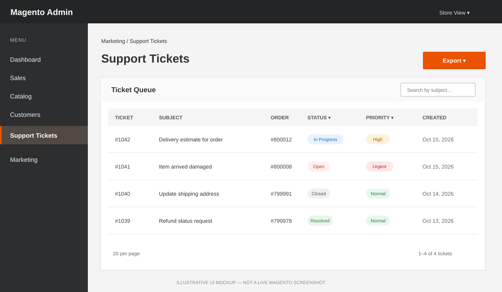
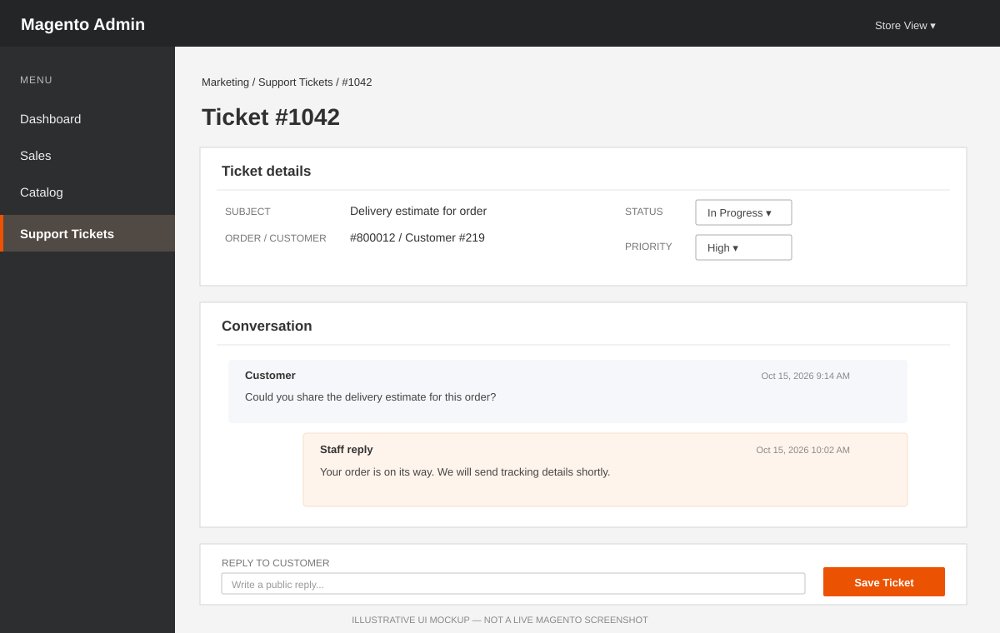

# Magento 2 Support Ticket REST API

`MagentoTickets_SupportTicketApi` adds an order-aware support workflow to Magento Open Source and Adobe Commerce. Customers can open a ticket about one of their own orders, follow the conversation, and reply through the REST API. Authorized staff can work the queue in the Magento Admin or use staff-only REST endpoints.

> **Project status:** Version 1 implementation. This repository does not include a Magento application; see [Compatibility and verification](#compatibility-and-verification) for the exact versions checked.

## What problem it solves

Magento's standard order history does not provide a customer-owned support conversation tied to an order. This module provides that missing workflow without trusting customer or order IDs supplied by the caller:

- Customers create tickets only for orders owned by their authenticated account.
- Customer list, detail, and reply operations are scoped to the customer token.
- Staff access is protected by Magento ACL permissions.
- Each ticket has a searchable status and priority in an Admin grid.
- Staff can reply from Admin or the REST API; each staff reply triggers a customer email notification.
- Ticket status advances through `open → in_progress → resolved → closed`.

The first version intentionally focuses on text conversations. Attachments, reminders, webhooks, and a separate React dashboard are not included.

## Admin preview

The images below are **illustrative UI mockups**, not screenshots captured from a running Magento installation. They show the intended ticket queue and conversation workflow; the Magento Admin theme and final rendering depend on the host installation.

### Ticket queue



### Ticket conversation



## Requirements and compatibility

| Component | Requirement / verification |
| --- | --- |
| Magento Open Source / Adobe Commerce | Target: 2.4.4 or later. Magento runtime compatibility has **not** been verified in this repository. |
| PHP | Package constraint: `^8.1`; local syntax validation was run with PHP 8.4.15. |
| Composer | Manifest validation was run with Composer 2.10.1. |

Do not interpret the target version as a Magento release tested by CI. Install and validate against the exact Magento/PHP matrix used by your store before production deployment.

## Installation

From the Magento root, clone the repository directly into Magento's module directory (replace the placeholder with the repository URL):

```bash
git clone <repository-url> app/code/MagentoTickets/SupportTicketApi
php bin/magento module:enable MagentoTickets_SupportTicketApi
php bin/magento setup:upgrade
php bin/magento cache:flush
```

If the source is already on disk, copy its contents into `app/code/MagentoTickets/SupportTicketApi` instead of cloning it.

For production mode, also run:

```bash
php bin/magento setup:di:compile
php bin/magento setup:static-content:deploy -f
```

Grant **Support Tickets → Manage Tickets** to the Admin roles that should access the queue, ticket details, and staff operations. The grid is available under **Marketing → Support Tickets**. Configure the Magento **Support** email identity and outgoing mail transport before testing staff notifications.

## REST API

All routes use the Magento REST base URL, for example `https://shop.example.com/rest/default/V1`. Customer routes require a customer bearer token. Staff routes require an admin bearer token whose role has the module's **Manage Tickets** ACL permission.

| Method | Route | Access | Purpose |
| --- | --- | --- | --- |
| `POST` | `/support-tickets` | Customer | Create a ticket for an owned order |
| `GET` | `/support-tickets` | Customer | List the caller's tickets; supports `searchCriteria` |
| `GET` | `/support-tickets/:ticketId` | Customer | Get an owned ticket and conversation |
| `POST` | `/support-tickets/:ticketId/replies` | Customer | Add a customer reply |
| `PUT` | `/support-tickets/:ticketId/status` | Staff ACL | Advance the ticket status one step |
| `PUT` | `/support-tickets/:ticketId/priority` | Staff ACL | Set priority |
| `POST` | `/support-tickets/:ticketId/replies/staff` | Staff ACL | Add a staff reply and email the customer |

The customer ID is injected from the authenticated token. It is not accepted as a client-controlled field. Tickets for another customer are returned as not found. Guest orders are not eligible.

### Get tokens

Request a customer token using a Magento customer account:

```bash
curl -X POST "$BASE_URL/integration/customer/token" \
  -H "Content-Type: application/json" \
  -d '{"username":"customer@example.com","password":"<customer-password>"}'
```

Request an Admin token for an Admin user assigned the module ACL:

```bash
curl -X POST "$BASE_URL/integration/admin/token" \
  -H "Content-Type: application/json" \
  -d '{"username":"<admin-username>","password":"<admin-password>"}'
```

Both endpoints return a token string. Send it on protected requests as `Authorization: Bearer <token>`. Store real credentials and tokens in a secure local secret store; do not commit them.

### Create a ticket

```bash
curl -X POST "$BASE_URL/support-tickets" \
  -H "Authorization: Bearer $CUSTOMER_TOKEN" \
  -H "Content-Type: application/json" \
  -d '{
    "orderId": 123,
    "subject": "Question about my order",
    "message": "Could you share the delivery estimate?"
  }'
```

New tickets have `open` status and `normal` priority. Subjects are limited to 255 characters and messages to 10,000 characters.

### List and view tickets

```bash
curl "$BASE_URL/support-tickets?searchCriteria%5BpageSize%5D=20&searchCriteria%5BcurrentPage%5D=1" \
  -H "Authorization: Bearer $CUSTOMER_TOKEN"

curl "$BASE_URL/support-tickets/456" \
  -H "Authorization: Bearer $CUSTOMER_TOKEN"
```

### Add a customer reply

```bash
curl -X POST "$BASE_URL/support-tickets/456/replies" \
  -H "Authorization: Bearer $CUSTOMER_TOKEN" \
  -H "Content-Type: application/json" \
  -d '{"message":"I have another detail to add."}'
```

### Update a ticket as staff

Status can only advance one step at a time: `open` to `in_progress`, `in_progress` to `resolved`, then `resolved` to `closed`.

```bash
curl -X PUT "$BASE_URL/support-tickets/456/status" \
  -H "Authorization: Bearer $ADMIN_TOKEN" \
  -H "Content-Type: application/json" \
  -d '{"status":"in_progress"}'

curl -X PUT "$BASE_URL/support-tickets/456/priority" \
  -H "Authorization: Bearer $ADMIN_TOKEN" \
  -H "Content-Type: application/json" \
  -d '{"priority":"high"}'

curl -X POST "$BASE_URL/support-tickets/456/replies/staff" \
  -H "Authorization: Bearer $ADMIN_TOKEN" \
  -H "Content-Type: application/json" \
  -d '{"message":"Your order is on its way. We will send tracking details shortly."}'
```

Allowed priorities are `low`, `normal`, `high`, and `urgent`. Staff replies are emailed to the customer address on the linked order.

## Postman collection

Import [`postman/Magento-Support-Ticket-API.postman_collection.json`](postman/Magento-Support-Ticket-API.postman_collection.json) into Postman. Set the collection variables:

| Variable | Example |
| --- | --- |
| `baseUrl` | `https://shop.example.com/rest/default/V1` |
| `customerEmail` / `customerPassword` | Credentials for a test customer |
| `adminUsername` / `adminPassword` | Credentials for a test Admin user with the module ACL |
| `orderId` | An existing order belonging to the test customer |
| `ticketId` | Automatically saved after **Create ticket** |

Run the relevant **Get customer token** or **Get admin token** request first. The collection scripts save the returned bearer tokens in `customerToken` and `adminToken`. The collection includes create/list/view/reply and staff status/priority/reply requests. Use non-production test accounts and orders.

## Data and security notes

- Declarative schema stores tickets and replies with foreign keys to Magento customers, sales orders, and their parent ticket.
- Customer operations check the authenticated customer identity and order/ticket ownership.
- Staff REST operations use the dedicated `MagentoTickets_SupportTicketApi::manage` ACL resource; Admin pages require the same permission.
- Message content is escaped when rendered in the Admin conversation and notification email.
- Replies are public conversation messages; do not include private staff-only notes or sensitive payment data.

## Compatibility and verification

Checks that can run without Magento were performed locally:

- PHP syntax: 23 PHP files, PHP 8.4.15.
- XML well-formedness: 11 XML files.
- Composer manifest: Composer 2.10.1.

Magento DI compilation, schema installation, REST authorization, email delivery, and Admin UI rendering still need to be verified in a Magento 2.4.4+ installation. There is no Magento application or integration test suite in this repository.
